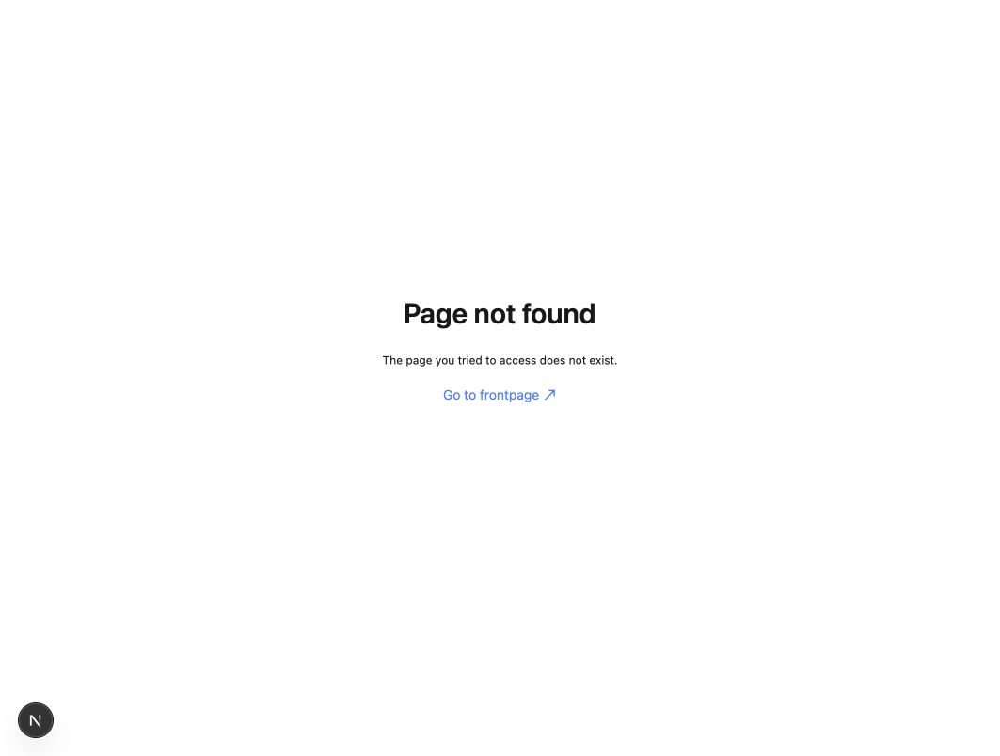

# BUG-001 — Account Customer Service link opens a 404 page

Status: **New — reproduced; owner triage pending**.
Observed: October 26, 2026 (Asia/Jakarta).
Original reporter/executor: AI QA assistant supporting the student's local portfolio project. The owner later reported reproducing the failure; see the separate confirmation note below.
Run: [RUN-20261026-001](../reports/RUN-20261026-001/REPORT.md).
Related case: TC-025. Criterion: AC-015, local navigation subset. Risk: RISK-007.

## Classification

- Proposed severity: **S3 Medium**. A visible account help entry point fails, while the catalog/cart/checkout flow remained usable in this run.
- Proposed fix priority: **D2**, for an upcoming reviewed fix batch. This is a recommendation, not an owner-approved deadline or risk waiver.
- Business/user impact: a customer following the promised customer-service/FAQ link cannot reach that information and instead leaves the account view for an error page.

## Environment and preconditions

- Application baseline: `204130a32d80b704ab509069dcc1a2f8a61f51c1`, with planning-only commit `a5e33cc` at current HEAD.
- macOS 26.0.1, Codex in-app browser, development mode. Installed app version 26.1021.31345; embedded framework directory 156.0.8078.48. The user-agent string was not recorded.
- Screenshot dimensions: 1063×804 pixels. No physical mobile device or other browser was used for reproduction.
- Storefront `http://localhost:8000`; backend `http://localhost:9000` healthy.
- Country path: `dk`. Anonymous account view; no special test data is required.
- Existing startup-generated files were present; no application fix was applied.

## Steps to reproduce

1. Open `http://localhost:8000/dk/account` while logged out.
2. Locate the **Got questions?** section below the sign-in form.
3. Click **Customer Service**.
4. Observe the destination URL and rendered page.

## Expected result

The customer-service link reaches a usable destination providing the help/FAQ content described by the account page, or another explicitly intended support destination. A visible first-party navigation link must not lead to a nonexistent route under the owner-approved local navigation baseline.

The exact final support content is a product decision. This report does not assume that a specific replacement page or FAQ design has already been approved.

## Actual result

- The link navigates to `http://localhost:8000/dk/customer-service`.
- The destination renders **Page not found** and **The page you tried to access does not exist.**
- An independently initiated HTTP request to that destination returned **404**.
- Observed frequency: **2 failures in 2 UI navigations** in this local session. Supplementary HTTP check: 1 request returned 404. This small sample is not a production failure-rate estimate.

## Evidence

- [Source account page and link — text snapshot](../reports/RUN-20261026-001/evidence/TC-025-account-help-link.txt)
- [Source account page — screenshot](../reports/RUN-20261026-001/evidence/TC-025-account-help-link.jpg)
- [First rendered 404 — text snapshot](../reports/RUN-20261026-001/evidence/BUG-001-customer-service-404.txt)
- [First rendered 404 — screenshot](../reports/RUN-20261026-001/evidence/BUG-001-customer-service-404.jpg)
- [Second reproduction — text snapshot](../reports/RUN-20261026-001/evidence/BUG-001-customer-service-404-reproduction2.txt)
- [Second reproduction — screenshot](../reports/RUN-20261026-001/evidence/BUG-001-customer-service-404-reproduction2.jpg)
- [HTTP response summaries](../reports/RUN-20261026-001/evidence/TC-025-link-responses.json)

## Diagnostic note and possible remediation

The link is declared as `href="/customer-service"` in `apps/storefront/src/modules/account/templates/account-layout.tsx`, line 33 of the inspected source. The localized link resolves it to `/dk/customer-service`. This identifies the source of the navigation target; no broader root-cause claim is made.

After product review, either point the link to the intended existing support destination or provide the missing route/content. Do not change application code until the Phase 7 fix is authorized.

Partial workaround: the local Contact page is reachable through the footer and rendered starter placeholder content in this run. It is not verified to supply the promised FAQ content or a working support channel.

## Retest and closure

No fix, regression test, retest, or closure has occurred. Keep TC-025 as Fail until a reviewed fix is exercised on an identified revision. Retest logged-out and authenticated account layouts, relevant country paths, and the selected replacement destination; preserve original failure evidence.

## Owner-reported reproduction follow-up

On October 26, 2026 the portfolio owner explicitly reported that Customer Service did not work and subsequently confirmed personally checking all 26 test cases manually. This supports a human-reported reproduction of BUG-001. The owner's attempt count, exact browser, timestamp, screenshots and detailed steps were not supplied; do not combine this with the original two AI UI attempts to calculate a new reproduction rate. See [the human verification note](../reports/RUN-20261026-001/HUMAN_VERIFICATION.md). The defect remains New/open; no fix retest or risk acceptance is implied.

## Mobile and tablet follow-up

In [RUN-20261026-002](../reports/RUN-20261026-002/REPORT.md), the account Customer Service link again rendered Page not found at 390 × 844 and 768 × 1024 viewport sizes. This is a repeat reproduction, not a fix retest. Status remains open.
