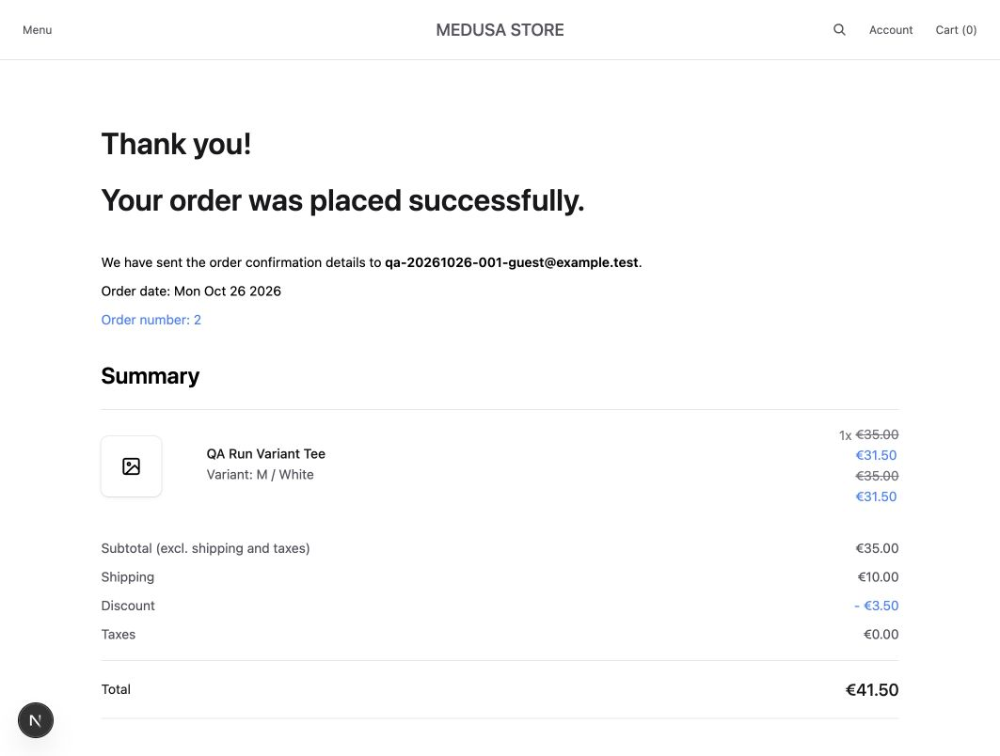

# Manual QA Execution Report — RUN-20261026-001

Disposition: **Completed with defects**. This is the first bounded local manual QA cycle, not whole-application acceptance or a release recommendation.

## Run manifest

- Date: October 26, 2026, Asia/Jakarta. Evidence files carry individual UTC timestamps. Browser evidence begins at 06:25 UTC (13:25 WIB); completion time is recorded in RESULTS.json. This interval is not a billable-effort estimate.
- Executor: AI QA assistant, operating an interactive browser and initiating one-off HTTP requests. The student authorized the local fixtures and basic acceptance baseline. The portfolio owner subsequently reported manually checking all 26 test cases and confirming the findings. This report presents one 26-case result set with AI assistance and owner-reported manual verification; the original evidence was captured by the assistant.
- Application baseline: `204130a32d80b704ab509069dcc1a2f8a61f51c1`; current HEAD includes planning commit `a5e33cc0de528eb7b20eeb547543ee65b8bbb66a`.
- Branch: `test/manual-qa`, based on the still-unmerged `docs/qa-test-plan` branch. No application code was manually changed for this cycle.
- Working-tree differences: existing startup-generated next-env.d.ts change and generated storefront AGENTS.md/CLAUDE.md files. The non-secret tracked diff is preserved in [startup-generated-diff.patch](evidence/startup-generated-diff.patch). New QA documentation/evidence is not part of the tested application logic.
- Environment: macOS 26.0.1 on Apple Silicon; Node.js 24.4.1; pnpm 10.11.1; PostgreSQL 15.17 on loopback port 15432; Medusa 2.22.0; Next.js 16.3.8; React storefront 19.0.5.
- Browser: Codex in-app browser. Installed app version `26.1021.31345`, embedded framework directory `156.0.8078.48`; user-agent string was not captured. This is not a separate Chrome/Firefox/WebKit matrix.
- Captured viewport image dimensions: 1063×804 pixels, as identified from screenshot files. The planned 1440×900 and 390×844 viewport checks were not performed, and device pixel ratio was not independently recorded.
- Mode: development servers at `http://localhost:8000` and `http://localhost:9000`; English UI, Europe/EUR, DK addresses, DK→FR navigation. Browser locale was not independently recorded; displayed local order time was consistent with WIB.
- Cache/session: ordinary dev-server caching; no controlled cold/warm policy. Anonymous cart flow, synthetic customer A login/logout, and separate A/B API tokens. No performance conclusions are drawn.
- Local prerequisite health: storefront HTTP 200, backend /health HTTP 200 OK, PostgreSQL accepting connections before testing.
- pnpm-lock.yaml SHA-256: `dc7e824ed7f530220fe58f83eb0efb196d65f233c2681ec6b7b4ca14fcec354b`.

## Scope and acceptance basis

The [26 cases](../../test-cases/MANUAL_TEST_CASES.md) were written before execution. On October 26 the owner explicitly authorized synthetic accounts/products/stock/promotions/carts/simulated orders without resetting existing data, and accepted the basic local portfolio baseline. Detailed business rules remain pending where not exercised by the concrete fixtures.

Results apply to each case's declared subset. They do not establish complete satisfaction of the broader acceptance criteria. Registration policy, verification/transfer, exhaustive authorization, tax/discount combinations, cross-region currency behavior, mobile/cross-browser testing, accessibility and performance remain outside this cycle.

## Fixture record and preservation

[FIXTURES.json](evidence/FIXTURES.json) records 16 new QA products, a dedicated category, authored EUR prices, stock-0/stock-1 variants, and a non-automatic 10% code. Thirteen simple products plus a variant product and two inventory-boundary products support deterministic checks. Two synthetic customer accounts and private addresses were created through Store/Auth APIs.

Products/category/stock/promotion preparation used supported Medusa workflows via a temporary CLI helper, not raw business-data SQL. Its first invocation stopped before mutation because its export format was incompatible; the export was corrected and fixture preparation succeeded. This was a test-harness setup issue, not an application defect. No existing data was reset/deleted and no application source/configuration was changed for fixture preparation.

Passwords and tokens remain in an ignored private local manifest outside this repo. Public evidence contains only synthetic `.test` identities and addresses. New carts and two simulated orders are retained locally; no real payment, fulfillment or email delivery was verified. Missing fixture images are intentional and not reported as application bugs.

## Results summary

| Measure | Actual result |
| --- | --- |
| Applicable included cases | 26 |
| Pass | 25 |
| Fail | 1 |
| Blocked / Not Run / Not Applicable | 0 / 0 / 0 |
| Execution progress | 26/26 = 100% of this bounded suite |
| Pass rate among executed | 25/26 = 96.15%; not a whole-site quality score |
| P1 cases | 17 Pass, 0 Fail, 0 Blocked, 0 Not Run |
| P2 cases | 8 Pass, 1 Fail |
| Unique reported defects | 1, proposed S3 / D2; not fixed |
| Full acceptance-criterion coverage | Not claimed; criteria are partially scoped and some decisions remain pending |
| Performance / accessibility | Not measured / not assessed in this phase |

### Case-level actual results

| Case | Priority | Status | Actual result | Evidence |
| --- | --- | --- | --- | --- |
| TC-001 | P2 | Pass | Home displayed the starter heading, menu, account/cart and category/policy links. | [TC-001-home.jpg](evidence/TC-001-home.jpg) |
| TC-002 | P2 | Pass | The dedicated QA category displayed only QA fixture products across its two pages. | [TC-002-TC-006-category-page1.txt](evidence/TC-002-TC-006-category-page1.txt) |
| TC-003 | P2 | Pass | Searching QA Run Product 13 displayed exactly one matching product at EUR 13.00. | [TC-003-search-match.txt](evidence/TC-003-search-match.txt) |
| TC-004 | P2 | Pass | The run-specific nonexistent token returned 0 products and a usable no-match message. | [TC-004-search-empty.txt](evidence/TC-004-search-empty.txt) |
| TC-005 | P2 | Pass | Inspected category results followed ascending EUR 1–12 and descending EUR 45, 40, 20, 13–5 order on page 1. | [TC-005-price-ascending.txt](evidence/TC-005-price-ascending.txt), [TC-005-price-descending.txt](evidence/TC-005-price-descending.txt) |
| TC-006 | P2 | Pass | Recorded 12 handles on page 1 and 4 on page 2: union 16, intersection 0, matching the 16 prepared category members. | [TC-002-TC-006-category-page1.txt](evidence/TC-002-TC-006-category-page1.txt), [TC-006-category-page2.txt](evidence/TC-006-category-page2.txt) |
| TC-007 | P1 | Pass | M and White were selected; the page showed EUR 35.00 and the matching fixture variant ID in the URL after hydration. | [TC-007-variant-M-White.txt](evidence/TC-007-variant-M-White.txt) |
| TC-008 | P2 | Pass | A nonexistent product displayed Page not found and a frontpage link. | [TC-008-product-not-found.jpg](evidence/TC-008-product-not-found.jpg) |
| TC-009 | P1 | Pass | The stock-0 fixture displayed Out of stock and a disabled purchase button. | [TC-009-zero-stock.txt](evidence/TC-009-zero-stock.txt) |
| TC-010 | P1 | Pass | Store API rejected quantity 2 for stock 1 with HTTP 400 insufficient_inventory; re-read cart contained no items. | [TC-010-stock-boundary.json](evidence/TC-010-stock-boundary.json) |
| TC-011 | P1 | Pass | The initially empty anonymous cart showed an empty-state message and Explore products, without a checkout action. | [TC-011-empty-cart.txt](evidence/TC-011-empty-cart.txt) |
| TC-012 | P1 | Pass | Cart contained QA Run Variant Tee, M / White, quantity 1 and EUR 35.00 after one add. | [TC-012-cart-selected-variant.txt](evidence/TC-012-cart-selected-variant.txt) |
| TC-013 | P1 | Pass | Changing quantity to 2 produced a EUR 70.00 line/subtotal/total, with zero shipping and tax at that state. | [TC-013-quantity-two-total-seventy.txt](evidence/TC-013-quantity-two-total-seventy.txt) |
| TC-014 | P1 | Pass | Reload retained the M / White line, quantity 2 and EUR 70.00 total. | [TC-014-cart-after-reload.txt](evidence/TC-014-cart-after-reload.txt) |
| TC-015 | P1 | Pass | Removing the QA line returned the cart to Cart (0) and the empty-state message. | [TC-015-item-removed.txt](evidence/TC-015-item-removed.txt) |
| TC-016 | P1 | Pass | Invalid code produced explicit rejection feedback; the single EUR 35.00 item had no discount and total remained EUR 35.00. | [TC-016-invalid-coupon.txt](evidence/TC-016-invalid-coupon.txt) |
| TC-017 | P1 | Pass | QA20261026TEN applied 10% to EUR 35.00: discount EUR 3.50 and pre-shipping total EUR 31.50. | [TC-017-valid-coupon-total.txt](evidence/TC-017-valid-coupon-total.txt) |
| TC-018 | P1 | Pass | Submitting an empty address stayed at step=address and displayed Please fill out this field at First name. | [TC-018-required-address-fields.jpg](evidence/TC-018-required-address-fields.jpg) |
| TC-019 | P1 | Pass | Fictional DK address advanced to delivery; Standard Shipping was EUR 10.00. Returning to Address preserved entered data; resubmission retained the shipping choice. | [TC-019-delivery-and-total.txt](evidence/TC-019-delivery-and-total.txt), [TC-019-address-persisted.txt](evidence/TC-019-address-persisted.txt) |
| TC-020 | P1 | Pass | Manual Payment created UI order number 2. Persisted M / White quantity 1 matched EUR 35.00 − 3.50 + 10.00 + 0.00 = EUR 41.50. | [TC-020-order-confirmed.jpg](evidence/TC-020-order-confirmed.jpg), [TC-020-persisted-order.json](evidence/TC-020-persisted-order.json) |
| TC-021 | P1 | Pass | Repeating completion on an isolated authenticated API cart returned the same order ID twice; order_cart held one distinct order. UI confirmation reload retained order number 2. | [TC-021-repeat-completion.json](evidence/TC-021-repeat-completion.json), [TC-021-confirmation-after-reload.txt](evidence/TC-021-confirmation-after-reload.txt) |
| TC-022 | P1 | Pass | Wrong synthetic credentials displayed Invalid email or password and did not show account data. | [TC-022-invalid-login.txt](evidence/TC-022-invalid-login.txt) |
| TC-023 | P1 | Pass | Valid A credentials showed A account and one address; logout plus reload showed the login form again. | [TC-023-valid-login.txt](evidence/TC-023-valid-login.txt), [TC-023-after-logout.txt](evidence/TC-023-after-logout.txt) |
| TC-024 | P1 | Pass | Address read/update as B returned 404 and anonymous returned 401; A address stayed unchanged. A private order history contained its order, B history was empty and anonymous history returned 401. Guest order-by-ID capability was excluded as documented. | [TC-024-address-ownership.json](evidence/TC-024-address-ownership.json), [TC-024-address-mutation.json](evidence/TC-024-address-mutation.json), [TC-024-order-history-ownership.json](evidence/TC-024-order-history-ownership.json) |
| TC-025 | P2 | Fail | Account Customer Service link navigated to /dk/customer-service and rendered Page not found in two UI attempts; independent HTTP request returned 404. Five footer policy/contact targets returned 200; Contact rendered documented starter placeholder text. See BUG-001. | [TC-025-account-help-link.txt](evidence/TC-025-account-help-link.txt), [BUG-001-customer-service-404.jpg](evidence/BUG-001-customer-service-404.jpg), [BUG-001-customer-service-404-reproduction2.txt](evidence/BUG-001-customer-service-404-reproduction2.txt), [TC-025-link-responses.json](evidence/TC-025-link-responses.json), [TC-025-contact-page.txt](evidence/TC-025-contact-page.txt) |
| TC-026 | P2 | Pass | Country selector changed Denmark to France at /fr/contact; the France product page showed EUR 20.00. Returning to the DK product route remained usable; different-region currencies and populated-cart transitions were not evaluated. | [TC-026-country-France.txt](evidence/TC-026-country-France.txt), [TC-026-France-EUR.txt](evidence/TC-026-France-EUR.txt), [TC-007-variant-M-White.txt](evidence/TC-007-variant-M-White.txt) |

## Defect and triage

[BUG-001](../../bug-reports/BUG-001-customer-service-link-404.md): the Customer Service link on the account page points to an unavailable route. Two UI navigations rendered the not-found page and an independent HTTP request returned 404. Severity S3 and fix priority D2 are proposed classifications; owner triage/acceptance is pending. No fix or retest is claimed.

## Important interpretation limits

- **Guest order retrieval is a capability route.** The installed GET /store/orders/:id implementation explicitly permits guest access by opaque order ID. TC-024 verifies private account order-history filtering and address read/update ownership, not account-bound protection of that guest route. Production suitability and further restrictions require policy review; no vulnerability claim is made from code inspection alone.
- **HTTP 200 alone is insufficient.** Next.js HTML can contain serialized not-found fallbacks even on normal pages. An initial substring indicator in the link-response record was renamed and annotated; it is not used as a rendered-page verdict. The reported broken link was directly verified through UI navigation.
- **Confirmation text is not email evidence.** The page says confirmation details were sent and displays a paid amount. Only local order persistence and manual-provider behavior were checked; no actual email receipt or real charge is claimed.
- **Case scope matters.** TC-005 checks category-page sorting, TC-006 checks its pagination, and TC-026 checks supported-country navigation in the same EUR region without a populated cart. They do not certify every catalog filter, a multi-currency transition, or mobile layouts.
- **Repeated completion is bounded.** TC-021 repeated one isolated API cart completion twice and confirmed one linked order, plus reloaded the separate UI confirmation. It is not a concurrency/load test or proof against all network races.

## Exit-gate assessment and next actions

All 17 included P1 cases passed their declared checks, but TC-025 failed and BUG-001 remains open. The bounded execution is complete; do not describe it as all tests passed. No owner waiver, production release approval or overall acceptance has been obtained.

Next actions: owner review of the report and defect; retain BUG-001 for Phase 7; continue to Phase 4 only on the owner's instruction; obtain installation/configuration approval before adding automation tooling. Preserve the failed result until an actual fix and retest exist.

These artifacts are local and uncommitted at report preparation. No CI job, public report or GitHub publication of Phase 3 is claimed. Screenshots and text snapshots are retained alongside this report; original request/response summaries are included without tokens. Inspect sanitization again before publication.

## Representative evidence

Completed local simulated checkout:

Verified broken account help link:

## Subsequent owner-reported verification

On October 26, 2026 the portfolio owner confirmed manually checking all 26 test cases and stated that the findings were correct, expanding the earlier confirmation of six selected flows to the full suite. The consolidated result remains 25 Pass / 1 Fail across 26 cases, with AI assistance and owner-reported manual verification. See [HUMAN_VERIFICATION.md](HUMAN_VERIFICATION.md) for attribution and evidence details. The original attached artifacts were captured by the assistant; no additional owner screenshots or per-step execution log were supplied. BUG-001 remains open; this confirmation is not a fix retest.

## Subsequent viewport coverage

[RUN-20261026-002](../RUN-20261026-002/REPORT.md) adds mobile and tablet viewport execution. It does not change the historical scope or results of this initial run.
