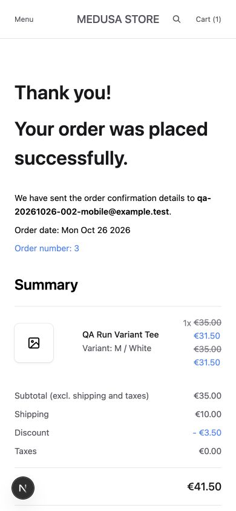
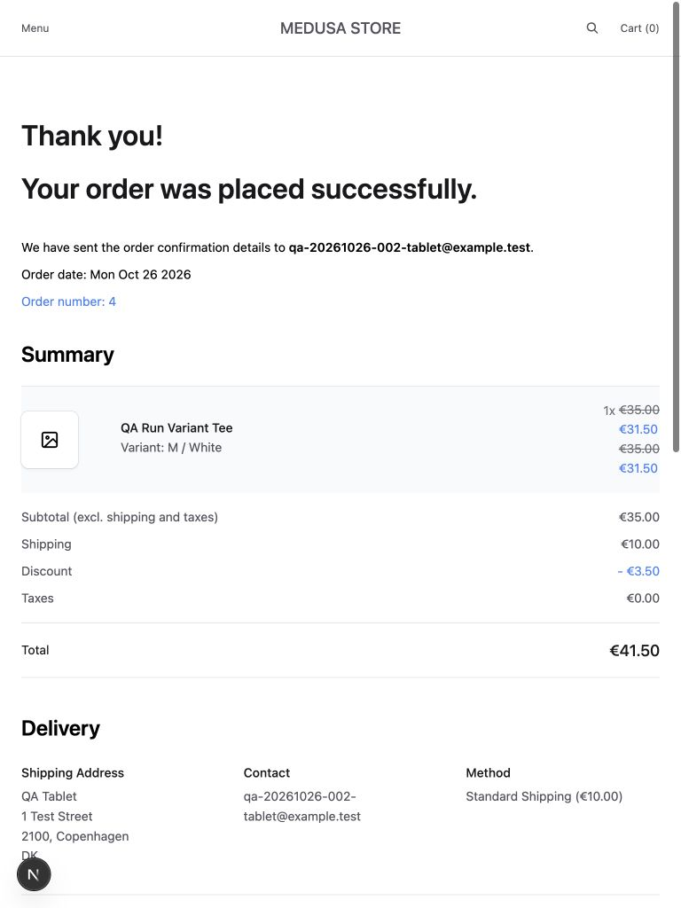

# Mobile and Tablet QA Follow-up — RUN-20261026-002

**Disposition: Completed with defects.** Customer Service still fails on both sizes; an additional minor mobile menu overflow was measured. No application fix or release acceptance is claimed.

## Environment and execution

- October 26, 2026; individual observation timestamps are UTC in [observations.json](evidence/observations.json). These timestamps are not an effort estimate.
- Local storefront `http://localhost:8000`, backend `http://localhost:9000`; development mode, same application baseline as [the initial run](../RUN-20261026-001/REPORT.md), branch `test/manual-qa`. No dependency, application source, or configuration changes were made for this follow-up.
- Codex in-app browser, desktop engine, explicit viewport sizes **390 × 844 CSS px** and **768 × 1024 CSS px**, confirmed using DOM measurements. This is viewport testing, not physical mobile/tablet, touch-input, Safari, or mobile user-agent testing. DPR and exact user-agent were not recorded.
- Executor: AI QA assistant using interactive browser actions and individually initiated HTTP checks. No Phase 4 regression framework was installed. The portfolio owner subsequently reported manually checking the mobile and tablet cases and confirmed agreement with the findings, including the reported defects. The original captured artifacts remain attributed to the assistant; no additional owner screenshots or per-step log were supplied.
- Reused the existing synthetic QA products, stock fixtures, coupon and A/B accounts. Created isolated carts and two simulated guest orders; no reset, real payment, production interaction, or verified email delivery. Fixture images are intentionally absent.
- Viewport override was reset after testing. Sessions were logged out. Additional QA carts from evidence recapture remain locally; they are not orders.

## Counting and results

| Scope | Pass | Fail | Notes |
| --- | --- | --- | --- |
| Mobile UI cases | 23 | 1 | 24 UI cases; TC-025 fails |
| Tablet UI cases | 23 | 1 | Same 24 UI cases independently exercised |
| Shared backend cases | 2 | 0 | TC-010 and TC-024; viewport-independent |
| Consolidated original suite | 25 | 1 | 26 unique cases; shared backend evidence applies to both sizes |
| Supplemental RSP-001 layout check | Tablet | Mobile | Separate from original functional case denominator |

TC-021 combines each viewport's confirmation reload with one shared backend repeat-completion check. Do not describe this as 52 independent full UI executions. There were no blocked or unexecuted included cases. The functional TC-001 pass does not mean every layout check passed.

## Case-level actual results

| Case | Mobile | Tablet | Actual result | Evidence |
| --- | --- | --- | --- | --- |
| TC-001 | Pass | Pass | Home and navigation loaded; menu opened and closed. Functional pass; supplemental menu overflow is tracked separately. | [mobile-TC-001-home](evidence/mobile-TC-001-home.txt), [mobile-menu-open](evidence/mobile-menu-open.txt), [tablet-TC-001-home](evidence/tablet-TC-001-home.txt), [tablet-menu-open](evidence/tablet-menu-open.txt) |
| TC-002 | Pass | Pass | QA category contained the 16 known fixtures across two pages. | [mobile-TC-002-category-loaded](evidence/mobile-TC-002-category-loaded.txt), [mobile-TC-006-page2](evidence/mobile-TC-006-page2.txt), [tablet-TC-002-category](evidence/tablet-TC-002-category.txt), [tablet-TC-006-page2](evidence/tablet-TC-006-page2.txt) |
| TC-003 | Pass | Pass | Exact title search returned only QA Run Product 13 at EUR 13. | [mobile-TC-003-search](evidence/mobile-TC-003-search.txt), [tablet-TC-003-search](evidence/tablet-TC-003-search.txt) |
| TC-004 | Pass | Pass | Nonmatching query returned zero products with usable empty-state feedback. | [mobile-TC-004-no-match](evidence/mobile-TC-004-no-match.txt), [tablet-TC-004-no-match](evidence/tablet-TC-004-no-match.txt) |
| TC-005 | Pass | Pass | Ascending prices were 1 through 12; descending were 45, 40, 20, 13 through 5 on the first page. | [mobile-TC-005-ascending](evidence/mobile-TC-005-ascending.txt), [mobile-TC-005-descending](evidence/mobile-TC-005-descending.txt), [tablet-TC-005-ascending](evidence/tablet-TC-005-ascending.txt), [tablet-TC-005-descending](evidence/tablet-TC-005-descending.txt) |
| TC-006 | Pass | Pass | Page 1 contained 12 handles and page 2 contained 4, covering all 16 fixtures without overlap. | [mobile-TC-002-category-loaded](evidence/mobile-TC-002-category-loaded.txt), [mobile-TC-006-page2](evidence/mobile-TC-006-page2.txt), [tablet-TC-002-category](evidence/tablet-TC-002-category.txt), [tablet-TC-006-page2](evidence/tablet-TC-006-page2.txt) |
| TC-007 | Pass | Pass | Selected M/White; displayed EUR 35 and matching selected variant state. | [mobile-TC-007-selected](evidence/mobile-TC-007-selected.txt), [tablet-TC-007-selected](evidence/tablet-TC-007-selected.txt) |
| TC-008 | Pass | Pass | Missing product rendered Page not found and a frontpage link. | [mobile-TC-008-missing](evidence/mobile-TC-008-missing.txt), [tablet-TC-008-missing](evidence/tablet-TC-008-missing.txt) |
| TC-009 | Pass | Pass | Stock-zero fixture showed Out of stock with disabled purchase controls. | [mobile-TC-009-zero-stock](evidence/mobile-TC-009-zero-stock.txt), [tablet-TC-009-zero-stock](evidence/tablet-TC-009-zero-stock.txt) |
| TC-010 | Shared Pass | Shared Pass | Shared API check: quantity 2 against stock 1 returned 400, code insufficient_inventory; cart remained empty. | [shared-TC-010](evidence/shared-TC-010.json) |
| TC-011 | Pass | Pass | Empty cart displayed explanatory text and Explore products. | [mobile-TC-011-empty](evidence/mobile-TC-011-empty.txt), [tablet-TC-011-empty](evidence/tablet-TC-011-empty.txt) |
| TC-012 | Pass | Pass | One M/White item appeared in the cart at EUR 35. Initial mobile attempt navigated away while the request was pending; retry waited for Cart (1). | [mobile-TC-012-cart-completed](evidence/mobile-TC-012-cart-completed.txt), [tablet-TC-012-cart](evidence/tablet-TC-012-cart.txt) |
| TC-013 | Pass | Pass | Quantity 2 gave EUR 70; quantity control remained usable. | [mobile-TC-013-quantity2](evidence/mobile-TC-013-quantity2.txt), [tablet-TC-013-quantity2](evidence/tablet-TC-013-quantity2.txt) |
| TC-014 | Pass | Pass | Reload retained M/White, quantity 2, and EUR 70. | [mobile-TC-014-reload](evidence/mobile-TC-014-reload.txt), [tablet-TC-014-reload](evidence/tablet-TC-014-reload.txt) |
| TC-015 | Pass | Pass | Removing the QA line returned the cart to the empty state. | [mobile-TC-015-removed](evidence/mobile-TC-015-removed.txt), [tablet-TC-015-removed](evidence/tablet-TC-015-removed.txt) |
| TC-016 | Pass | Pass | Invalid promotion was rejected with feedback; EUR 35 remained unchanged. | [mobile-TC-016-invalid-coupon](evidence/mobile-TC-016-invalid-coupon.txt), [tablet-TC-016-invalid-coupon](evidence/tablet-TC-016-invalid-coupon.txt) |
| TC-017 | Pass | Pass | QA20261026TEN applied a EUR 3.50 discount to EUR 35, giving EUR 31.50 before delivery. | [mobile-TC-017-valid-coupon](evidence/mobile-TC-017-valid-coupon.txt), [tablet-TC-017-valid-coupon](evidence/tablet-TC-017-valid-coupon.txt) |
| TC-018 | Pass | Pass | Blank required fields prevented advancement; native validity reported missing values. | [mobile-TC-018-required](evidence/mobile-TC-018-required.txt), [tablet-TC-018-required](evidence/tablet-TC-018-required.txt) |
| TC-019 | Pass | Pass | Fictional DK address persisted when revisited; Standard Shipping cost EUR 10. | [mobile-TC-019-delivery](evidence/mobile-TC-019-delivery.txt), [mobile-TC-019-address-revisited](evidence/mobile-TC-019-address-revisited.txt), [tablet-TC-019-delivery](evidence/tablet-TC-019-delivery.txt), [tablet-TC-019-address-revisited](evidence/tablet-TC-019-address-revisited.txt) |
| TC-020 | Pass | Pass | Manual Payment produced a local order: M/White x1, EUR 35 - 3.50 + 10 shipping + 0 tax = EUR 41.50. | [mobile-TC-020-review](evidence/mobile-TC-020-review.txt), [mobile-TC-020-order](evidence/mobile-TC-020-order.txt), [tablet-TC-020-review](evidence/tablet-TC-020-review.txt), [tablet-TC-020-order](evidence/tablet-TC-020-order.txt) |
| TC-021 | Pass | Pass | Confirmation reload retained the same device-specific order. Shared API repeat completion returned the same existing order twice; database counts were one distinct order per checked cart. | [mobile-TC-021-confirmation-reload](evidence/mobile-TC-021-confirmation-reload.txt), [tablet-TC-021-confirmation-reload](evidence/tablet-TC-021-confirmation-reload.txt), [shared-TC-021](evidence/shared-TC-021.json), [shared-TC-021-order-counts](evidence/shared-TC-021-order-counts.json) |
| TC-022 | Pass | Pass | Wrong password produced Invalid email or password and did not grant account access. | [mobile-TC-022-invalid-login](evidence/mobile-TC-022-invalid-login.txt), [tablet-TC-022-invalid-login](evidence/tablet-TC-022-invalid-login.txt) |
| TC-023 | Pass | Pass | Valid A login showed the account; logout followed by reload returned to sign-in. | [mobile-TC-023-signed-in](evidence/mobile-TC-023-signed-in.txt), [mobile-TC-023-signed-out](evidence/mobile-TC-023-signed-out.txt), [tablet-TC-023-signed-in](evidence/tablet-TC-023-signed-in.txt), [tablet-TC-023-signed-out](evidence/tablet-TC-023-signed-out.txt) |
| TC-024 | Shared Pass | Shared Pass | Shared API check: A address read 200, B 404, anonymous 401; B/anonymous updates 404/401 and owner data unchanged. A order history contained its order, B history empty, anonymous 401. Guest order-by-ID capability excluded. | [shared-TC-024](evidence/shared-TC-024.json) |
| TC-025 | Fail | Fail | Shipping, returns, terms, privacy and contact destinations loaded. Account Customer Service navigation rendered 404: BUG-001 remains open. Starter placeholder policy/contact copy is disclosed, not treated as a new responsive defect. | [mobile-TC-025-shipping](evidence/mobile-TC-025-shipping.txt), [mobile-TC-025-returns](evidence/mobile-TC-025-returns.txt), [mobile-TC-025-terms](evidence/mobile-TC-025-terms.txt), [mobile-TC-025-privacy](evidence/mobile-TC-025-privacy.txt), [mobile-TC-025-contact](evidence/mobile-TC-025-contact.txt), [mobile-TC-025-help-404](evidence/mobile-TC-025-help-404.txt), [tablet-TC-025-shipping](evidence/tablet-TC-025-shipping.txt), [tablet-TC-025-returns](evidence/tablet-TC-025-returns.txt), [tablet-TC-025-terms](evidence/tablet-TC-025-terms.txt), [tablet-TC-025-privacy](evidence/tablet-TC-025-privacy.txt), [tablet-TC-025-contact](evidence/tablet-TC-025-contact.txt), [tablet-TC-025-help-404](evidence/tablet-TC-025-help-404.txt) |
| TC-026 | Pass | Pass | Menu country selector switched DK to FR; variant page retained EUR pricing; returned to usable DK pages. | [mobile-TC-026-fr](evidence/mobile-TC-026-fr.txt), [tablet-TC-026-fr](evidence/tablet-TC-026-fr.txt) |

## Orders and independent amounts

- Mobile: `order_01M5VYWKEJZDP7Z7G85EPRMMDR`, display number 3. Tablet: `order_01M5VZ00B0HJPF4N83BM92AEJ0`, display number 4.
- Both: EUR 35 item basis × 10% = EUR 3.50 discount; EUR 35 − EUR 3.50 + EUR 10 shipping + EUR 0 tax = **EUR 41.50**. Confirmation and reload retained these values.
- The repeated API completion reused the initial run's completed isolated API cart, returned its original order twice, and the read-only database check found one distinct order for that cart and each newly completed UI cart. This is sequential repeat coverage, not a concurrency test.

## Supplemental responsive finding

[BUG-002 — Mobile menu extends beyond the viewport](../../bug-reports/BUG-002-mobile-menu-overflow.md): with the menu open, viewport width 390, document scrollWidth 398, panel left 8/right 398/width 390. The transform was none in a subsequent read. Closing the menu restored scrollWidth 390. At tablet width 768, the open panel right edge was 391 and document width stayed 768. This is a measured 8 px layout overflow; no critical action was blocked. Proposed severity S4 / priority D3, pending owner triage. No WCAG failure or physical-device behavior is inferred.

## Evidence handling and limitations

- The initial screenshot helper retained its original device label when the viewport changed, causing tablet captures to overwrite similarly named mobile artifacts. Filenames were corrected using actual image dimensions, then affected mobile flows were revisited and recaptured. Observation history retains repeated attempts. Mobile order confirmation was recaptured from the already-created order; no extra order was placed during recapture.
- An initial mobile add-to-cart attempt navigated away while Loading was still shown. The retry waited for Cart (1) before navigation. This incomplete attempt is not classified as a confirmed app defect. Early pending-state artifacts are retained but are not the final oracle.
- Some locator actions did not navigate or timed out on ambiguous matches; fresh state and accessibility controls verified the destinations. A transient cart-width measurement during navigation was not promoted to a defect because later stable cart captures returned to 390 px. Stable menu overflow was independently rechecked.
- API execution was initially blocked by the terminal sandbox; the localhost-enabled retry succeeded. A database read initially lacked credentials; the subsequent read used the existing local environment without printing secrets.
- Portrait sizes only. No landscape matrix, rotation, physical keyboard/virtual keyboard, touch gestures, browser engine matrix, throttling, Lighthouse, axe, WCAG conformance or exhaustive breakpoint claim.

## Review screenshots

Remain in Phase 3 until the owner authorizes the next phase. Both defects remain open.

## Owner-reported manual confirmation

On October 26, 2026, the portfolio owner stated that the mobile and tablet test cases had also been checked manually and agreed with the findings. This confirmation supplements the same case matrix; it does not add extra cases or change 25 Pass / 1 Fail in the consolidated functional suite. BUG-001 and BUG-002 remain open. Exact owner execution timestamps, device/browser details and additional evidence were not supplied, so physical-device coverage is not inferred.

Publication housekeeping: trailing whitespace in text snapshots was normalized without changing their text content. The startup-generated patch remains an unchanged diagnostic artifact; its blank context line contains the space required by unified-diff format.
